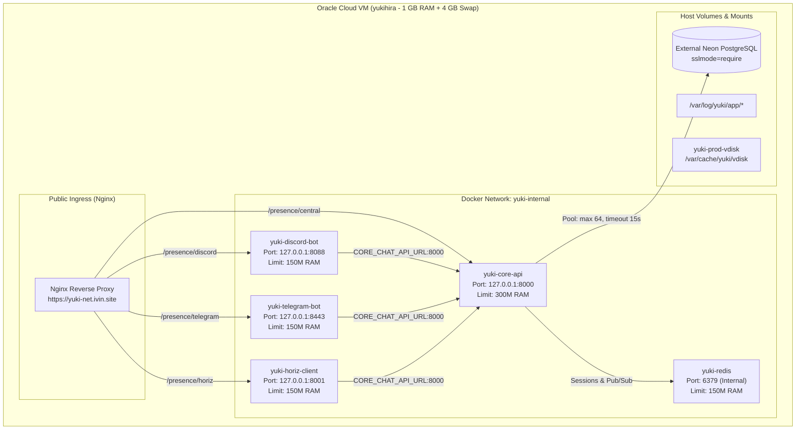

# Project Yuki Infrastructure Architecture & SRE Operational Reference

This document serves as the canonical ground-truth operational reference for PocketSRE's AI triage engine and responding SREs. It directly reflects Project Yuki's production deployment specifications, ADRs, Docker configurations, and operational constraints as established in Project Yuki (`/media/ivintitus/Data/My Projects/Main/Project-Yuki`).

---

## 1. Host Environment & Physical Topography

* **Hosting Provider:** Oracle Cloud Infrastructure (OCI) Compute Instance (Dedicated Ubuntu Linux VM).
* **Hardware Tier:** AMD Micro Instance (**1 GB Physical RAM + 4 GB Swap**).
  - *SRE Critical Note:* Due to strict 1 GB RAM bounds, memory pressure is the leading cause of container instability. Containers enforce strict Docker memory limits (`limits.memory`).
* **Hostname:** `yukihira` (or environment-configured `YUKI_HOSTNAME`).
* **Network Co-location:** Sits on the same OCI Virtual Cloud Network (VCN) subnet as PocketSRE's Control-Plane VM, accessible over the private network via Paramiko 5.1+ SSH as non-root user `pocketsre` (with whitelisted sudoers).
* **Core Filesystem Layout:**
  - Application Root: `/home/ubuntu/yuki`
  - Deployment & Ops: `/home/ubuntu/yuki/deploy`
  - State & Locks: `/var/lib/yuki/state` (Deployment lock: `/var/lib/yuki/state/deploy.lock`)
  - Forensics Store: `/var/lib/yuki/forensics/{common,core-api,telegram-bot,discord-bot,horiz-client}`
  - Volatile Secrets (Tmpfs): `/dev/shm/yuki-secrets/current/` (Infisical-managed; physical `.env` files are prohibited on SSD)
  - Image Pins: `/home/ubuntu/yuki/.env.images` (Stores immutable `image:<SHA>@sha256:<digest>` pins)
  - Persistent Application Logs: `/var/log/yuki/app/{service_role}/` (`human.log` and `machine.jsonl`)
  - Common & Deploy Logs: `/var/log/yuki/common/` (`watchdog.log`, `deploy.log`)

---

## 2. Service Naming Taxonomy (ADR-026 Alignment)

Project Yuki enforces a strict three-layer naming taxonomy. Conflating these layers causes operational failures:

| Service Description | Layer 1: Canonical Key | Layer 2: Service Role | Layer 3: Qualified Docker Name | Presence Health `service` Field |
| :--- | :--- | :--- | :--- | :--- |
| **Core Chat API** | `core-api` | `core-api` | **`yuki-core-api`** | `core-chat-api` *(Known discrepancy)* |
| **Discord Gateway** | `discord` | `discord-bot` | **`yuki-discord-bot`** | `yuki-discord-bot` |
| **Telegram Gateway** | `telegram` | `telegram-bot` | **`yuki-telegram-bot`** | `yuki-telegram-bot` |
| **Hori-Z Connector** | `horiz` | `horiz-client` | **`yuki-horiz-client`** | `yuki-horiz-client` |
| **Redis Broker** | `infra` | `redis` | **`yuki-redis`** | N/A (Internal dependency) |

*PocketSRE Container Resolution Rule:* PocketSRE normalizes any incoming service string (`core-chat-api`, `yuki-core`, `core-api`) directly to the Layer 3 qualified Docker name (`yuki-core-api`) before issuing shell commands.

---

## 3. Docker Compose & Container Architecture

All services operate inside Docker on the internal bridge network `yuki-internal`. External exposure is strictly loopback-bound (`127.0.0.1`) and reverse-proxied through Nginx.



### Container Specifications:
1. **`yuki-redis`:**
   - Image: `redis:7-alpine@sha256:...`
   - Memory Limit: 150 MB (`--maxmemory 100mb`, `--maxmemory-policy volatile-lru`)
   - User: `redis` (Unprivileged)
   - Volume: `yuki-prod-redis-data` mounted at `/data`
2. **`yuki-core-api`:**
   - Memory Limit: 300 MB
   - Healthcheck: `curl -f http://localhost:8000/` (15s interval, 5s timeout, 3 retries)
   - External DB: Neon Serverless PostgreSQL (`POOL_MAX_SIZE=64`, `POOL_ACQUIRE_TIMEOUT=15.0s`, `DB_COMMAND_TIMEOUT=15.0s`)
   - Dependency: Strict dependency on `yuki-redis` (`condition: service_healthy`)
3. **`yuki-discord-bot`:**
   - Memory Limit: 150 MB
   - Dependency: Depends on `yuki-core-api` (`condition: service_healthy`)
   - Internal Port: `127.0.0.1:8088`
4. **`yuki-telegram-bot`:**
   - Memory Limit: 150 MB
   - Dependency: Depends on `yuki-core-api` (`condition: service_healthy`)
   - Internal Port: `127.0.0.1:8443`
5. **`yuki-horiz-client`:**
   - Memory Limit: 150 MB
   - Dependency: Depends on `yuki-core-api` (`condition: service_healthy`)
   - Internal Port: `127.0.0.1:8001`

---

## 4. Public Gateway & Telemetry Endpoints (ADR-024)

`https://yuki-net.ivin.site` is the sole public ingress gateway. Nginx enforces an explicit allow-list; catch-all routing is strictly prohibited.

### Public Ingress Allow-List:
* `GET /brain`
* `GET /presence/central` $\rightarrow$ forwards to `http://127.0.0.1:8000/health/`
* `GET /presence/discord` $\rightarrow$ forwards to `http://127.0.0.1:8088/health`
* `GET /presence/telegram` $\rightarrow$ forwards to `http://127.0.0.1:8443/health`
* `GET /presence/horiz` $\rightarrow$ forwards to `http://127.0.0.1:8001/health`
* `POST /webhook/telegram/{token}`
* `POST /token/generate` & `POST /chat-demo` (Restricted to Vercel website `yuki.ivin.site` server routes via M2M authentication)

---

## 5. Dual-Channel Observability & Telemetry

### Channel 1: Proactive Telemetry (Presence Endpoints)
Polled by PocketSRE every 15–30 seconds via HTTP GET.

#### Schema 1: Core Service (`/presence/central`)
```json
{
  "uptime_seconds": 168736,
  "gate_mode": "ACCEPTING",
  "db_status": "ok",
  "redis_status": "ok",
  "flags": {
    "deploy_ready": true,
    "restart_recommended": false,
    "maintenance_mode": false
  },
  "status": "online",
  "service": "core-chat-api",
  "app_version": "6.4.2",
  "commit_sha": "d21460dd5a9c560a2993423f7246051a0e5ec7ac",
  "degraded_subsystems": []
}
```
* **Failure Triggers:**
  - `status != "online"`
  - `gate_mode != "ACCEPTING"`
  - `db_status != "ok"` or `redis_status != "ok"`
  - `degraded_subsystems.length > 0`
  - `flags.restart_recommended == true`

#### Schema 2: Gateway Edge Clients (`/presence/discord`, `/presence/telegram`, `/presence/horiz`)
```json
{
  "status": "online",
  "service": "yuki-discord-bot",
  "uptime_seconds": 168775,
  "platform_connection_state": "connected",
  "flags": {
    "deploy_ready": true,
    "restart_recommended": false,
    "maintenance_mode": false
  },
  "app_version": "2.3.2",
  "commit_sha": "ad0fa5f012ded1c94a4e0ca0f605f26715224de2",
  "degraded_subsystems": []
}
```
* **Failure Triggers:**
  - `status != "online"`
  - `platform_connection_state != "connected"` *(Critical: A container process may be running while disconnected from Discord/Telegram gateway; `platform_connection_state` is the semantic readiness indicator)*.
  - `flags.restart_recommended == true`

---

### Channel 2: Reactive Host Watchdog (`watchdog.py`)
* **Execution:** Host-side script executed every 1–2 minutes via managed crontab (`DEPLOY_DIR/cron/yuki.crontab`).
* **Alert Destination:** Discord Webhook:
  `https://discord.com/api/webhooks/1516923595903864963/03DE8KxXouAORIWNIxe6zHtGuVEGka6HV4nVpwKebVLJNuFBRFOzZaLD8VHwARO_JLk0`
* **Watchdog Evaluation Rules:**
  - Host RAM warning triggered if usage > 80%
  - Host CPU warning triggered if usage > 80% (recovers at < 50%)
  - Container health check failures or unexpected restarts
  - Sanitized forensic snapshots written to `/var/lib/yuki/forensics/{category}` (retained for 3 days; raw PII/tokens scrubbed)

---

## 6. Incident Blast Radius & Dependency Matrix

When diagnosing outages, PocketSRE's AI triage engine follows Yuki's upstream/downstream dependency rules:

```
[Neon PostgreSQL] ────┐
                      ▼
[yuki-redis] ───► [yuki-core-api] ───┬──► [yuki-discord-bot]
                                     ├──► [yuki-telegram-bot]
                                     └──► [yuki-horiz-client]
```

1. **Root Dependency Failure (`yuki-redis` down):**
   - *Symptom:* `core-api` fails healthchecks or reports `redis_status: "error"`.
   - *Blast Radius:* Complete platform degradation. Edge clients cannot complete chat requests.
   - *Remediation:* Restart `yuki-redis`, verify healthy, then restart `yuki-core-api` if necessary.
2. **Core API Failure (`yuki-core-api` down):**
   - *Symptom:* `/presence/central` returns 502/timeout. Edge clients log connection drops to `http://core-api:8000`.
   - *Blast Radius:* Edge clients stay alive but mark `platform_connection_state = "degraded"`.
   - *Remediation:* Inspect `yuki-core-api` logs for database lockouts, OOM termination, or AI key depletion. Restart `yuki-core-api`.
3. **Edge Client Disconnection (`yuki-discord-bot` disconnected):**
   - *Symptom:* Process is running, but `/presence/discord` reports `platform_connection_state: "disconnected"`.
   - *Blast Radius:* Isolated to Discord users. Core API and Telegram remain unaffected.
   - *Remediation:* Restart `yuki-discord-bot`.
4. **Active Deployment Guard (`deploy.lock`):**
   - *Rule:* If `/var/lib/yuki/state/deploy.lock` exists, a CI/CD release workflow is actively modifying images or staging configurations. Bounded runbooks MUST warn the operator before cycling containers during an active deployment.

---

## 7. Bounded Runbook Catalog (Sudoers Least-Privilege)

All remote actions execute via Paramiko SSH as user `pocketsre` against whitelisted binaries:

```bash
# 1. Telemetry Inspection
sudo /usr/bin/docker logs --tail 50 <container_name>
sudo /usr/bin/docker inspect <container_name>

# 2. Lifecycle Remediation (Requires Lead Approval or Autonomous Policy)
sudo /usr/bin/docker restart <container_name>
sudo /usr/bin/docker stop <container_name>
sudo /usr/bin/docker start <container_name>
```

### Approved Container Targets:
* `yuki-core-api`
* `yuki-horiz-client`
* `yuki-discord-bot`
* `yuki-telegram-bot`
* `yuki-redis`

---

## 8. PocketSRE SSH Access & Sudoers Whitelist (Verified Ground Truth)

This section is the canonical source of truth for PocketSRE's remote execution surface on the Yuki VM. The runbook/tool registry in `src/app/actions/` MUST stay in sync with the sudoers whitelist below — a tool that maps to a command not listed here will fail at the target host.

### 8.1 Connection Details (Verified Working)

```bash
# Target host: <POCKETSRE_TARGET_SSH_HOST> (yukihira — OCI VM; set in .env)
# Auth: Ed25519 key pair, unprivileged user `pocketsre`
ssh -i ~/.ssh/<pocketsre_bot_ed25519> pocketsre@<POCKETSRE_TARGET_SSH_HOST> 'sudo /usr/bin/docker logs --tail 10 yuki-telegram-bot'
```

* Private key path on PocketSRE VM / in container: `/app/.ssh/<pocketsre_bot_ed25519>` (chmod 600, `POCKETSRE_TARGET_SSH_KEY_PATH`)
* `pocketsre` user on Yuki VM: passwordless-login disabled; sudo limited to the whitelist below
* Shell pipelines work around sudo: `sudo docker logs <c> | grep -i error` — grep runs unprivileged in the remote shell, so log filtering needs no sudoers expansion
* Paramiko client must set `AutoAddPolicy` for missing host keys (FAIL-3.4)

### 8.2 `/etc/sudoers.d/pocketsre` (Live — `visudo -cf` Verified)

```text
# --- Container Lifecycle (Strictly Pinned to Yuki Containers) ---
pocketsre ALL=(ALL) NOPASSWD: /usr/bin/docker restart yuki-discord-bot
pocketsre ALL=(ALL) NOPASSWD: /usr/bin/docker restart yuki-telegram-bot
pocketsre ALL=(ALL) NOPASSWD: /usr/bin/docker restart yuki-horiz-client
pocketsre ALL=(ALL) NOPASSWD: /usr/bin/docker restart yuki-core-api
pocketsre ALL=(ALL) NOPASSWD: /usr/bin/docker restart yuki-redis

pocketsre ALL=(ALL) NOPASSWD: /usr/bin/docker start yuki-discord-bot
pocketsre ALL=(ALL) NOPASSWD: /usr/bin/docker start yuki-telegram-bot
pocketsre ALL=(ALL) NOPASSWD: /usr/bin/docker start yuki-horiz-client
pocketsre ALL=(ALL) NOPASSWD: /usr/bin/docker start yuki-core-api
pocketsre ALL=(ALL) NOPASSWD: /usr/bin/docker start yuki-redis

pocketsre ALL=(ALL) NOPASSWD: /usr/bin/docker stop yuki-discord-bot
pocketsre ALL=(ALL) NOPASSWD: /usr/bin/docker stop yuki-telegram-bot
pocketsre ALL=(ALL) NOPASSWD: /usr/bin/docker stop yuki-horiz-client
pocketsre ALL=(ALL) NOPASSWD: /usr/bin/docker stop yuki-core-api
pocketsre ALL=(ALL) NOPASSWD: /usr/bin/docker stop yuki-redis

# --- Container Read-Only Diagnostics & Logs (Any Options / Tail Counts) ---
pocketsre ALL=(ALL) NOPASSWD: /usr/bin/docker logs *
pocketsre ALL=(ALL) NOPASSWD: /usr/bin/docker inspect *
pocketsre ALL=(ALL) NOPASSWD: /usr/bin/docker top *

# --- Global Docker Telemetry & Pruning ---
pocketsre ALL=(ALL) NOPASSWD: /usr/bin/docker ps
pocketsre ALL=(ALL) NOPASSWD: /usr/bin/docker ps -a
pocketsre ALL=(ALL) NOPASSWD: /usr/bin/docker stats --no-stream
pocketsre ALL=(ALL) NOPASSWD: /usr/bin/docker system prune -f

# --- Host Ingress & Web Server (NGINX) ---
pocketsre ALL=(ALL) NOPASSWD: /usr/bin/systemctl restart nginx
pocketsre ALL=(ALL) NOPASSWD: /usr/bin/systemctl status nginx
pocketsre ALL=(ALL) NOPASSWD: /usr/bin/nginx -t
pocketsre ALL=(ALL) NOPASSWD: /usr/bin/journalctl -u nginx *

# --- Host Docker Daemon Status ---
pocketsre ALL=(ALL) NOPASSWD: /usr/bin/systemctl status docker
pocketsre ALL=(ALL) NOPASSWD: /usr/bin/journalctl -u docker *
```

### 8.3 Sudo Syntax Rules (Modern Ubuntu / sudo 1.9+)

The Yuki VM runs a recent Ubuntu where sudo rejects legacy constructs. Rules for any whitelist expansion:

* **Trailing wildcards only** — `/usr/bin/docker logs *` is valid; wildcards mid-command (e.g. `docker logs --tail * x`) are rejected.
* **Absolute paths always** — sudo refuses relative binary paths; pin `/usr/bin/...` exactly.
* **No deprecated directives** — `requiretty` was removed in sudo 1.9; including it produces invalid-config warnings. Keep the file free of `Defaults` lines unless verified.
* **Permissions:** file owned root, `chmod 440`.
* **Always validate after edits:** `sudo visudo -cf /etc/sudoers.d/pocketsre`.

### 8.4 Safe Expansion Candidates

Commands that may be added using the same pattern when PocketSRE needs them (each requires sudoers update + tool-registry update + `visudo -cf`):

```text
pocketsre ALL=(ALL) NOPASSWD: /usr/bin/systemctl status postgresql
pocketsre ALL=(ALL) NOPASSWD: /usr/bin/systemctl status sshd
pocketsre ALL=(ALL) NOPASSWD: /usr/bin/journalctl -u postgresql *
pocketsre ALL=(ALL) NOPASSWD: /usr/bin/df -h
pocketsre ALL=(ALL) NOPASSWD: /usr/bin/free -m
pocketsre ALL=(ALL) NOPASSWD: /usr/bin/uptime
```

(Note: `df`, `free`, `uptime` run fine unprivileged — sudo entries only needed if invoked under elevated diagnostic paths.)
